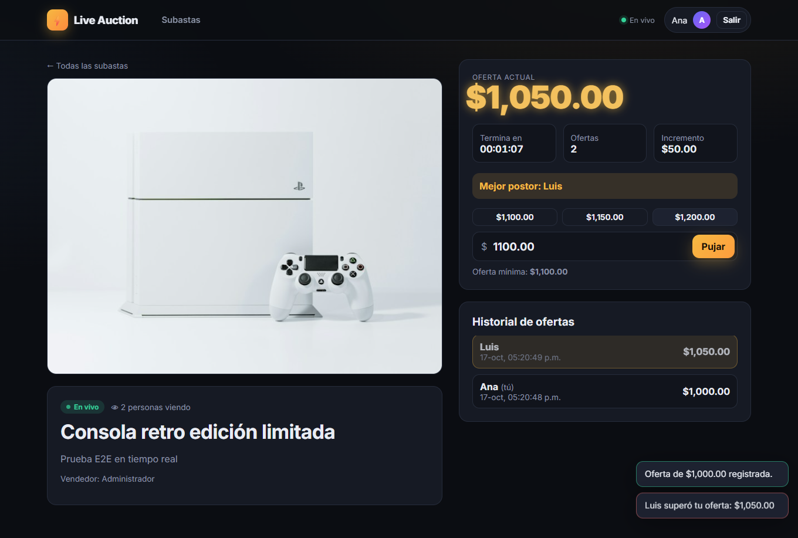
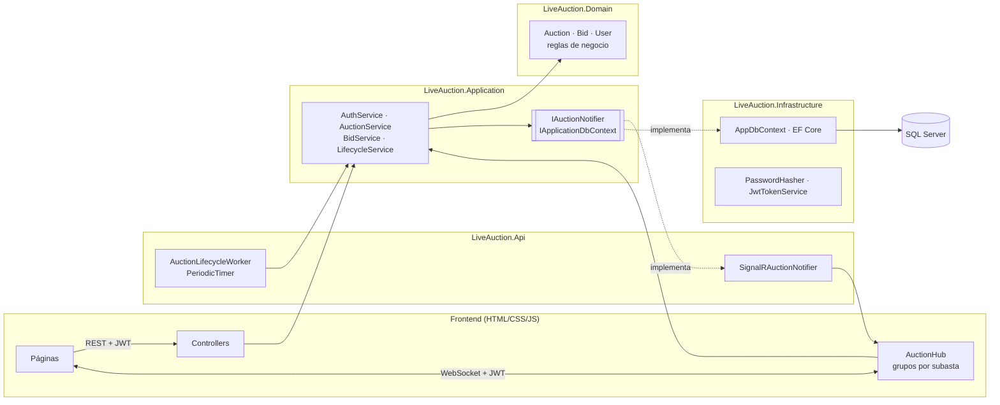
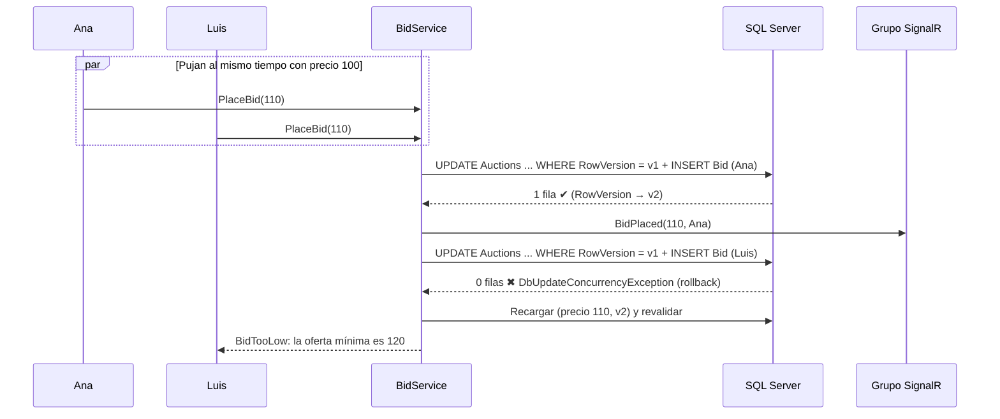
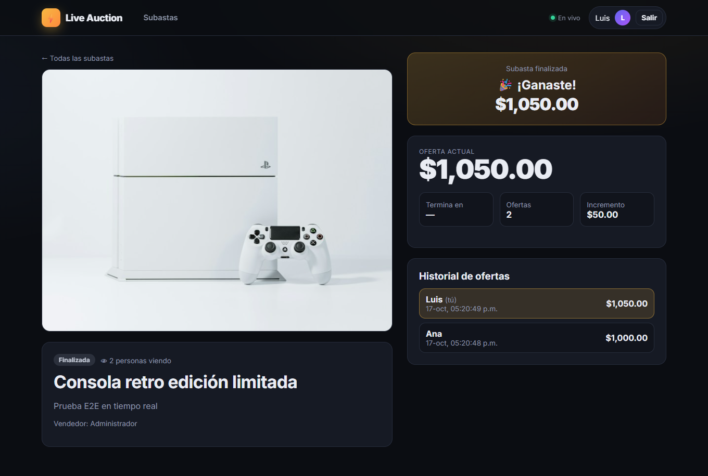
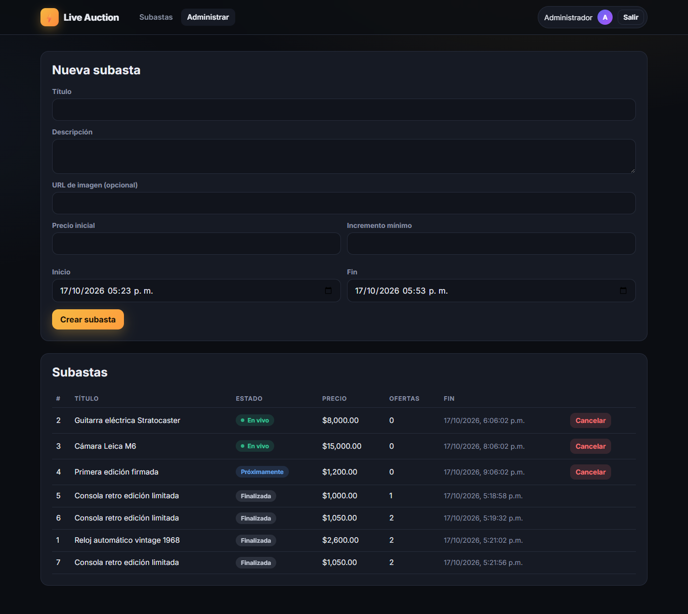

# ⚡ Live Auction

[](https://github.com/edu-tech220/live-auction/actions/workflows/ci.yml)


Plataforma de **subastas en tiempo real**: los usuarios pujan y todos los conectados ven el precio
cambiar al instante, sin recargar. El servidor valida cada oferta, resuelve la **concurrencia**
entre postores simultáneos y cierra cada subasta a su hora, de forma **idempotente**, aunque el
servidor se haya reiniciado.



## Lo interesante de este proyecto

- **Pujas concurrentes correctas.** Concurrencia optimista con `rowversion` y reintentos, más un
  índice único como red de seguridad. Probado con 20 postores simultáneos contra SQL Server real.
- **El servidor es la fuente de verdad.** El cliente solo manda el monto: el usuario sale del JWT,
  el precio de la BD y la hora del servidor. Un evento de SignalR se emite **solo después** de que
  la puja se guardó.
- **Cierre automático idempotente.** Un `BackgroundService` cierra las subastas vencidas. Con 10
  cerradores en paralelo hay exactamente un ganador y una notificación, y tras un reinicio cierra
  todo lo pendiente.
- **SignalR bien usado.** Hub fuertemente tipado, un grupo por subasta, rechazos solo para quien
  pujó, conteo de espectadores y resincronización al reconectar.
- **Seguridad.** PBKDF2, JWT validado por completo, política de autorización por defecto, rate
  limiting por IP y por usuario (también dentro del Hub), CORS explícito y sin secretos en el repo.
- **Calidad.** 71 pruebas (unitarias e integración con SQL Server y clientes SignalR reales), CI
  en GitHub Actions con smoke test de Docker Compose, y warnings tratados como errores.

## Arquitectura



Las dependencias van en una sola dirección (`Api → Infrastructure → Application → Domain`).
REST, SignalR y el worker **comparten los mismos servicios**: no hay reglas duplicadas.
Detalle y alternativas evaluadas en [docs/decisions.md](docs/decisions.md).

### Flujo de una puja con concurrencia



## Stack

| Área | Tecnología |
|---|---|
| Backend | C# 14, ASP.NET Core 10 (Web API), SignalR |
| Datos | Entity Framework Core 10 (Code First), SQL Server 2022 |
| Seguridad | JWT Bearer, PasswordHasher (PBKDF2), Rate Limiting, CORS |
| Frontend | HTML, CSS, JavaScript (ES modules), `@microsoft/signalr` |
| Pruebas | xUnit, WebApplicationFactory, SignalR .NET Client, FakeTimeProvider |
| DevOps | Docker, Docker Compose, GitHub Actions |

## Ejecutar con Docker (recomendado)

```bash
cp .env.example .env        # y cambia los valores
docker compose up --build
```

| Servicio | URL |
|---|---|
| Frontend | http://localhost:8080 |
| API + Swagger | http://localhost:5080/swagger |
| Health check | http://localhost:5080/health |

Se crean el administrador del `.env` y, si defines `DEMO_PASSWORD`, los postores `ana@demo.local` y
`luis@demo.local` con subastas de ejemplo. Abre dos navegadores (uno normal y uno en incógnito),
entra con cada usuario a la misma subasta y puja.

## Ejecutar en local (sin Docker)

Requisitos: .NET SDK 10 y SQL Server (Express sirve) en `.\SQLEXPRESS`.

```powershell
# 1. Secretos de desarrollo (no se guardan en el repo)
dotnet user-secrets set "Jwt:SigningKey" "<clave-aleatoria-de-32+-caracteres>" --project src/LiveAuction.Api
dotnet user-secrets set "Database:Seed:AdminPassword" "<contraseña-admin>" --project src/LiveAuction.Api
dotnet user-secrets set "Database:Seed:DemoPassword" "<contraseña-demo>" --project src/LiveAuction.Api

# 2. API (aplica migraciones y crea datos demo al arrancar en Development)
dotnet run --project src/LiveAuction.Api --launch-profile http    # http://localhost:5080/swagger

# 3. Frontend (cualquier servidor estático en el puerto 5500)
cd frontend
python -m http.server 5500                                         # http://localhost:5500
```

Administrador local: `admin@liveauction.local` con la contraseña que configuraste.

## API REST

| Método | Ruta | Acceso | Descripción |
|---|---|---|---|
| POST | `/api/auth/register` | Público | Registro (siempre rol `Bidder`) → JWT |
| POST | `/api/auth/login` | Público | Inicio de sesión → JWT |
| GET | `/api/auth/me` | Usuario | Perfil propio |
| GET | `/api/auctions?status=&search=&page=&pageSize=` | Público | Catálogo paginado |
| GET | `/api/auctions/{id}` | Público | Detalle + `minimumNextBid` + `serverTime` |
| POST | `/api/auctions` | Admin | Crear subasta |
| PUT | `/api/auctions/{id}` | Admin | Editar (solo programada y sin ofertas) |
| POST | `/api/auctions/{id}/cancel` | Admin | Cancelar |
| GET | `/api/auctions/{id}/bids` | Público | Historial (nombres visibles, nunca correos) |
| POST | `/api/auctions/{id}/bids` | Usuario | Pujar (alternativa REST al Hub) |
| GET | `/api/me/bids` | Usuario | Mis pujas |
| GET | `/health` | Público | Estado de la API y la BD |

Los errores son **ProblemDetails** (RFC 9457) con un `code` estable: `BidTooLow`, `AuctionEnded`,
`AlreadyHighestBidder`, `SellerCannotBid`, `AuctionNotStarted`, `TooManyBids`…

## SignalR — `/hubs/auctions`

| Dirección | Nombre | Descripción |
|---|---|---|
| Cliente → servidor | `JoinAuction(id)` | Se une al grupo y devuelve el estado actual (resincroniza) |
| Cliente → servidor | `LeaveAuction(id)` | Sale del grupo |
| Cliente → servidor | `JoinLobby()` | Recibe cambios de todas las subastas (catálogo) |
| Cliente → servidor | `PlaceBid(id, amount)` 🔒 | Puja; devuelve `BidOutcome` |
| Servidor → grupo | `BidPlaced` | Nueva puja confirmada (incluye `bidCount` como secuencia) |
| Servidor → quien pujó | `BidRejected` | Motivo del rechazo, solo para el invocador |
| Servidor → grupo | `ViewersChanged` | Número de personas viendo |
| Servidor → grupo | `AuctionStatusChanged` | Activada o cancelada |
| Servidor → grupo | `AuctionFinished` | Ganador y precio final (o sin ganador) |

## Pruebas

```bash
dotnet test        # 71 pruebas
```

| Suite | Qué cubre |
|---|---|
| **Unitarias (33)** | Reglas de `Auction` (montos, tiempos, vendedor, cierre idempotente), `ConnectionTracker` (también bajo concurrencia), JWT y hash de contraseñas |
| **Integración (38)** | API completa con `WebApplicationFactory` contra **SQL Server real** y reloj controlable: auth y seguridad, administración, pujas, **20 postores simultáneos**, **10 cerradores en paralelo**, recuperación tras reinicio y **clientes SignalR reales** (grupos, rechazos al invocador, espectadores, resultado final) |

Las pruebas de integración usan `.\SQLEXPRESS` en local o la variable `LIVEAUCTION_TEST_CONNECTION`
(así corren en CI contra SQL Server en contenedor).

## Estructura

```
src/
  LiveAuction.Domain/          Entidades y reglas (Auction, Bid, User, Result/Error)
  LiveAuction.Application/     Casos de uso, DTOs, puertos, ConnectionTracker
  LiveAuction.Infrastructure/  EF Core, migraciones, PasswordHasher, JWT, seed
  LiveAuction.Api/             Controllers, AuctionHub, worker, seguridad, Dockerfile
tests/
  LiveAuction.UnitTests/
  LiveAuction.IntegrationTests/
frontend/                      HTML + CSS + JS (independiente), Dockerfile (Nginx)
docs/decisions.md              Decisiones técnicas y alternativas evaluadas
```

## Capturas

| Catálogo en vivo | Resultado final |
|---|---|
|  |  |

| Administración | Móvil |
|---|---|
|  |  |

## Próximos pasos

- Backplane de SignalR (Redis) para escalar a varias instancias.
- Anti-sniping: extender el cierre unos segundos si llega una puja al final.
- Refresh tokens y cookie `HttpOnly` mediante un BFF.
- Pruebas de carga (k6) sobre el endpoint de pujas.
