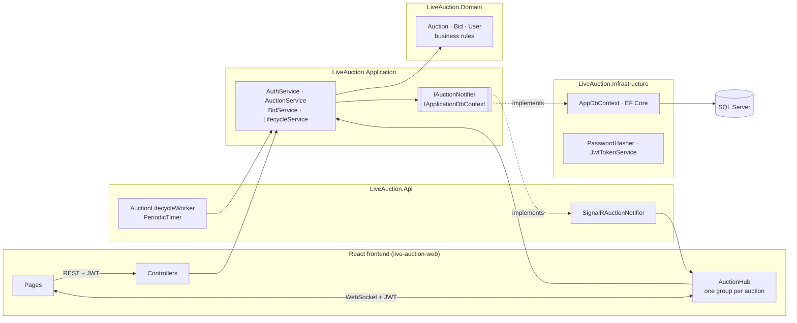
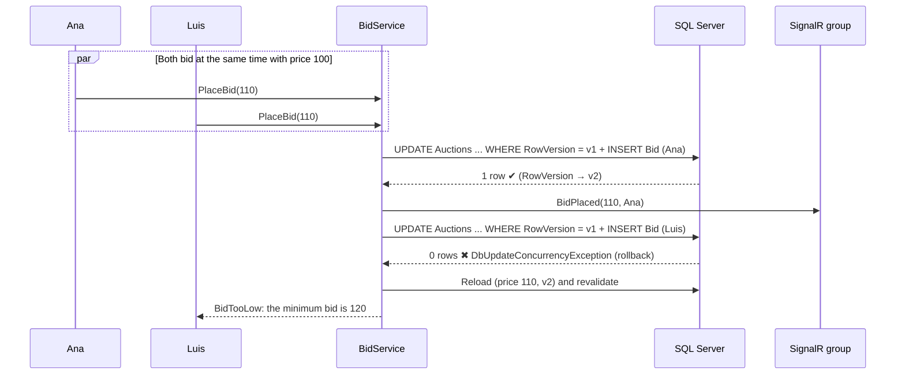
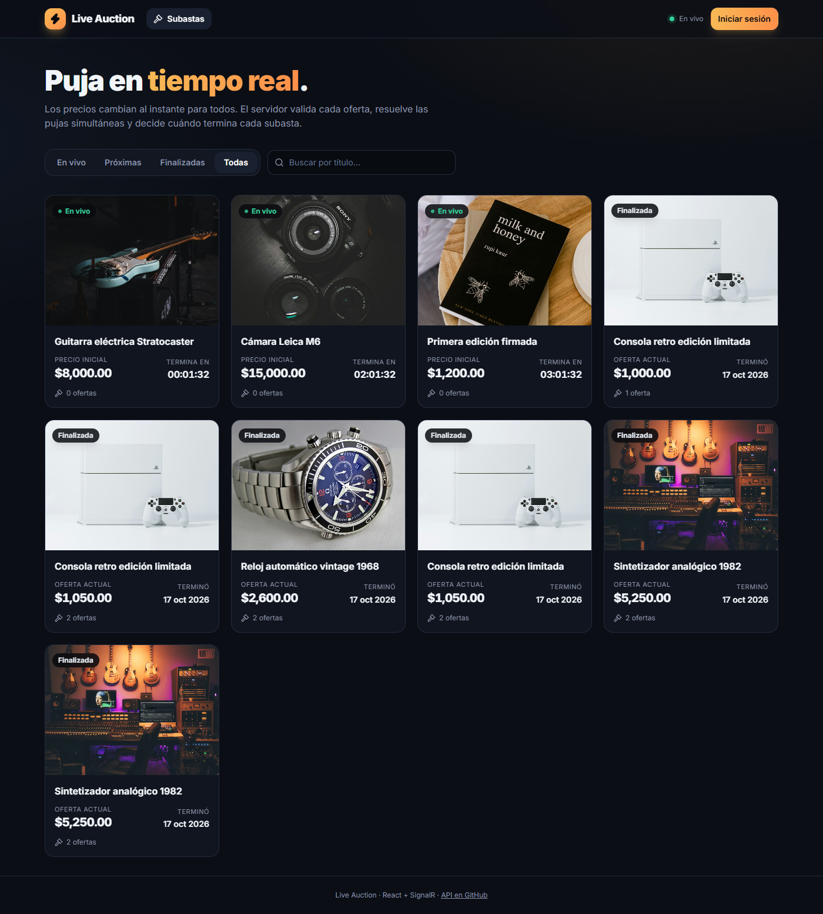
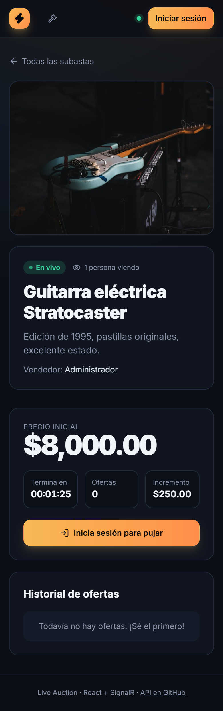

# ⚡ Live Auction

[](https://github.com/edu-tech220/live-auction/actions/workflows/ci.yml)


A **real-time auction platform**: users place bids and everyone connected sees the price change
instantly, without reloading. The server validates every bid, resolves **concurrency** between
simultaneous bidders, and closes each auction on time, **idempotently**, even after a restart.

> 🖥️ **Frontend:** [edu-tech220/live-auction-web](https://github.com/edu-tech220/live-auction-web) — React 19 + TypeScript + Vite + TanStack Query + SignalR.


## Highlights

- **Correct concurrent bidding.** Optimistic concurrency with `rowversion` and retries, plus a unique
  index as a safety net. Tested with 20 simultaneous bidders against a real SQL Server.
- **The server is the source of truth.** The client only sends the amount: the user comes from the
  JWT, the current price from the database and the time from the server. A SignalR event is emitted
  **only after** the bid has been persisted.
- **Idempotent automatic closing.** A `BackgroundService` closes expired auctions. With 10 closers
  running in parallel there is exactly one winner and one notification, and after a restart every
  overdue auction is closed.
- **SignalR done right.** Strongly typed hub, one group per auction, rejections sent only to the
  bidder, viewer counts and resynchronization on reconnect.
- **Security.** PBKDF2 password hashing, fully validated JWT, default authorization policy, rate
  limiting per IP and per user (inside the hub too), explicit CORS and no secrets in the repository.
- **Quality.** 71 tests (unit and integration with a real SQL Server and real SignalR clients),
  GitHub Actions CI with a Docker Compose smoke test, and warnings treated as errors.

## Architecture



Dependencies point in one direction (`Api → Infrastructure → Application → Domain`). REST, SignalR
and the background worker **share the same services**, so no rule is duplicated. Rationale and the
alternatives that were evaluated are in [docs/decisions.md](docs/decisions.md).

### A concurrent bid, step by step



## Tech stack

| Area | Technology |
|---|---|
| Backend | C# 14, ASP.NET Core 10 (Web API), SignalR |
| Data | Entity Framework Core 10 (Code First), SQL Server 2022 |
| Security | JWT Bearer, PasswordHasher (PBKDF2), rate limiting, CORS |
| Frontend | React 19, TypeScript, Vite, TanStack Query, Tailwind, `@microsoft/signalr` ([separate repo](https://github.com/edu-tech220/live-auction-web)) |
| Tests | xUnit, WebApplicationFactory, SignalR .NET client, FakeTimeProvider |
| DevOps | Docker, Docker Compose, GitHub Actions |

## Run with Docker (recommended)

```bash
cp .env.example .env        # then change the values
docker compose up --build
```

| Service | URL |
|---|---|
| Frontend (React, built from its own repo) | http://localhost:8080 |
| API + Swagger | http://localhost:5080/swagger |
| Health check | http://localhost:5080/health |

The admin from `.env` is created on startup and, if `DEMO_PASSWORD` is set, two demo bidders
(`ana@demo.local`, `luis@demo.local`) and sample auctions. Open two browsers (one regular, one
incognito), sign in as each user, open the same auction and bid.

## Run locally (without Docker)

Requirements: .NET SDK 10 and SQL Server (Express works) at `.\SQLEXPRESS`.

```powershell
# 1. Development secrets (never committed)
dotnet user-secrets set "Jwt:SigningKey" "<random-key-with-32+-characters>" --project src/LiveAuction.Api
dotnet user-secrets set "Database:Seed:AdminPassword" "<admin-password>" --project src/LiveAuction.Api
dotnet user-secrets set "Database:Seed:DemoPassword" "<demo-password>" --project src/LiveAuction.Api

# 2. API (applies migrations and seeds demo data on startup in Development)
dotnet run --project src/LiveAuction.Api --launch-profile http    # http://localhost:5080/swagger

# 3. Frontend (separate repository)
git clone https://github.com/edu-tech220/live-auction-web
cd live-auction-web && npm install && npm run dev                  # http://localhost:5173
```

Local admin: `admin@liveauction.local` with the password you configured.

## REST API

| Method | Route | Access | Description |
|---|---|---|---|
| POST | `/api/auth/register` | Public | Sign up (always the `Bidder` role) → JWT |
| POST | `/api/auth/login` | Public | Sign in → JWT |
| GET | `/api/auth/me` | User | Own profile |
| GET | `/api/auctions?status=&search=&page=&pageSize=` | Public | Paged catalog |
| GET | `/api/auctions/{id}` | Public | Details + `minimumNextBid` + `serverTime` |
| POST | `/api/auctions` | Admin | Create an auction |
| PUT | `/api/auctions/{id}` | Admin | Edit (only while scheduled and without bids) |
| POST | `/api/auctions/{id}/cancel` | Admin | Cancel |
| GET | `/api/auctions/{id}/bids` | Public | Bid history (display names, never emails) |
| POST | `/api/auctions/{id}/bids` | User | Place a bid (REST alternative to the hub) |
| GET | `/api/me/bids` | User | My bids |
| GET | `/health` | Public | API and database status |

Errors are **ProblemDetails** (RFC 9457) with a stable `code`: `BidTooLow`, `AuctionEnded`,
`AlreadyHighestBidder`, `SellerCannotBid`, `AuctionNotStarted`, `TooManyBids`, ...

## SignalR — `/hubs/auctions`

| Direction | Name | Description |
|---|---|---|
| Client → server | `JoinAuction(id)` | Joins the group and returns the current state (resync) |
| Client → server | `LeaveAuction(id)` | Leaves the group |
| Client → server | `JoinLobby()` | Receives changes from every auction (catalog) |
| Client → server | `PlaceBid(id, amount)` 🔒 | Places a bid; returns a `BidOutcome` |
| Server → group | `BidPlaced` | A confirmed bid (`bidCount` acts as a sequence number) |
| Server → caller | `BidRejected` | Rejection reason, sent only to the bidder |
| Server → group | `ViewersChanged` | Number of people watching |
| Server → group | `AuctionStatusChanged` | Activated or cancelled |
| Server → group | `AuctionFinished` | Winner and final price (or no winner) |

## Tests

```bash
dotnet test        # 71 tests
```

| Suite | Coverage |
|---|---|
| **Unit (33)** | `Auction` rules (amounts, timing, seller, idempotent close), `ConnectionTracker` (including under concurrency), JWT and password hashing |
| **Integration (38)** | The full API with `WebApplicationFactory` against a **real SQL Server** and a controllable clock: auth and security, administration, bidding, **20 simultaneous bidders**, **10 parallel closers**, recovery after a restart and **real SignalR clients** (groups, caller-only rejections, viewers, final result) |

Integration tests use `.\SQLEXPRESS` locally or the `LIVEAUCTION_TEST_CONNECTION` environment
variable (that is how CI runs them against a SQL Server container).

## Project structure

```
src/
  LiveAuction.Domain/          Entities and rules (Auction, Bid, User, Result/Error)
  LiveAuction.Application/     Use cases, DTOs, ports, ConnectionTracker
  LiveAuction.Infrastructure/  EF Core, migrations, PasswordHasher, JWT, seeding
  LiveAuction.Api/             Controllers, AuctionHub, worker, security, Dockerfile
tests/
  LiveAuction.UnitTests/
  LiveAuction.IntegrationTests/
docs/decisions.md              Technical decisions and the alternatives evaluated
```

## Screenshots

| Live catalog | Final result |
|---|---|
|  |  |

| Administration | Mobile |
|---|---|
|  |  |

## Next steps

- SignalR backplane (Redis) to scale out to several instances.
- Anti-sniping: extend the closing time by a few seconds when a bid arrives at the end.
- Refresh tokens and an `HttpOnly` cookie through a BFF.
- Load testing (k6) on the bidding endpoint.

## License

[MIT](LICENSE)
